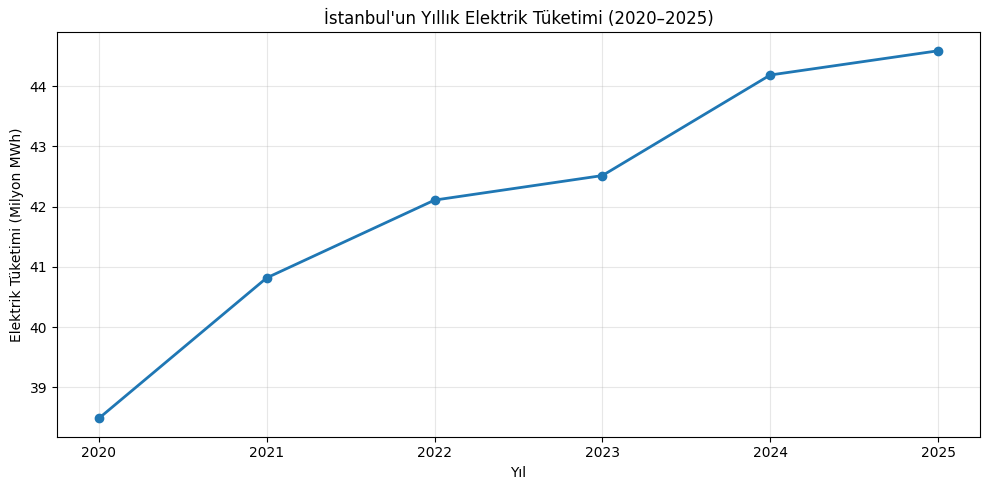
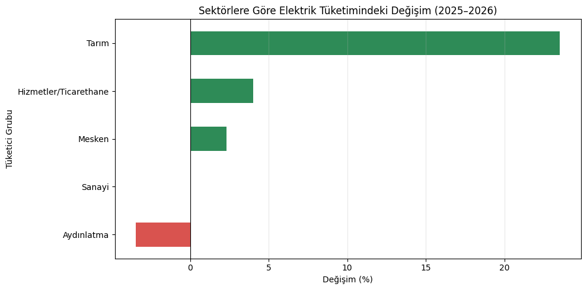
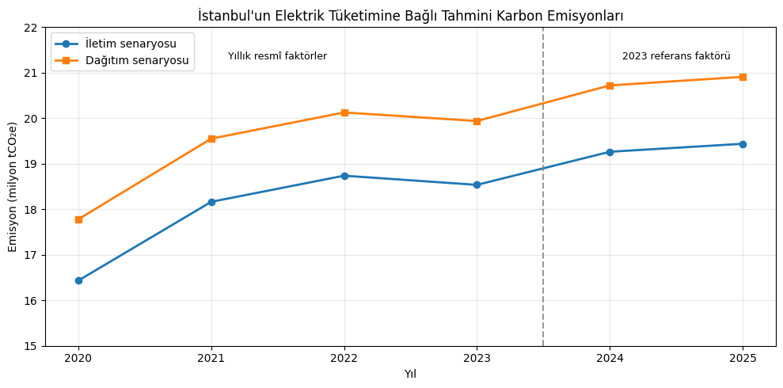

# İstanbul'da Sektörel Elektrik Tüketimi ve Elektrik Kaynaklı Karbon Emisyonları

**Rana Beyza Culus · SoftITo Veri Analitiği – 2**  
**Dönem:** Ocak 2020–Ağustos 2026 · **Durum:** Tamamlandı ve teslim edildi

İstanbul'un faturalanan elektrik tüketimini sektör, yıl ve ay düzeyinde analiz ettim; elektrik tüketimine bağlı tahmini sera gazı emisyonlarını iletim ve dağıtım senaryoları altında hesapladım. Çalışma, veri kalitesi kontrollerinden bulguların yorumlanmasına kadar tek bir Jupyter not defterinde izlenebilir.

[Analiz not defterini aç](112_istanbul_elektrik_karbon_analizi.ipynb) · [Veri setini incele](istanbul_aylik_sektorel_elektrik_tuketimi_2020_2026_agustos.csv) · [Kaynak ve yöntem notları](SOURCES.md)

## Öne çıkan bulgular

| Gösterge | Sonuç | Yorumlama kapsamı |
| --- | --- | --- |
| Yıllık elektrik tüketimi | 2020: **38,49 milyon MWh** → 2025: **44,59 milyon MWh** | Tam yıllar |
| En yüksek tüketim payı | 2025'te Hizmetler/Ticarethane: **%41,37** | Yıllık toplam içindeki pay |
| Aynı dönem tüketim değişimi | 2026 Ocak–Ağustos: **%2,39 artış** | 2025'in aynı sekiz ayına göre |
| Emisyon faktörünün etkisi | 2023'te tüketim artarken dağıtım senaryosu emisyonu azaldı | Tüketim ile yıllık emisyon faktörü birlikte değerlendirilir |

## Analizden görseller

### Yıllık elektrik tüketimi



2026 tamamlanmadığı için bu tam yıl grafiğine dahil edilmemiştir.

### Aynı dönem karşılaştırması



Grafik yalnızca **Ocak–Ağustos** dönemlerini karşılaştırır. Tarımın toplam tüketimdeki payı çok düşük olduğundan yüksek yüzdesel değişimi, en yüksek mutlak katkı olarak yorumlanmamalıdır.

### Elektrik kaynaklı emisyon senaryoları



2020–2023 hesaplarında ilgili yılın faktörü; 2024–2025 hesaplarında **2023 referans faktörü** kullanılmıştır. İletim ve dağıtım eğrileri alternatif senaryolardır; toplanmaz. Görseller teslim edilen not defterinin kayıtlı çıktılarından alınmıştır.

## Veri ve yöntem

Veri seti **80 ay × 5 tüketici grubu = 400 kayıt** içerir. Kaynak EPDK'nın Elektrik Piyasası Aylık Sektör Raporlarıdır; tüketim birimi **MWh**'dir.

- Eksik değer, tekrarlı kayıt, veri türü ve pozitif tüketim kontrolleri uygulandı.
- Yıllar içinde değişen tüketici grubu adları ortak sınıflara eşlendi; kaynak adları korundu.
- Sektör bazlı IQR incelemesinde işaretlenen **12 aykırı gözlem**, komşu aylarla değerlendirildi ve veri setinden çıkarılmadı.
- Yıllık ve aylık toplamlar, sektör payları, mevsimsellik ve aynı dönem değişimleri incelendi.
- Emisyonlar **tüketim (MWh) × emisyon faktörü (tCO₂e/MWh)** ile iki ayrı bağlantı senaryosunda hesaplandı.

**Kullanılan araçlar:** Python, Pandas, NumPy, Matplotlib ve Jupyter Notebook.

## Çalıştırma

Python 3 ve `pip` gereklidir. Terminalde:

```bash
git clone https://github.com/Beyzarana7/softito-veri-analitigi-2.git
cd softito-veri-analitigi-2/01-istanbul-elektrik-karbon-analizi
python -m venv .venv
```

Sanal ortamı etkinleştirin:

```bash
# Windows PowerShell
.venv\Scripts\Activate.ps1

# macOS / Linux
source .venv/bin/activate
```

Ardından:

```bash
python -m pip install -r requirements.txt
python -m notebook 112_istanbul_elektrik_karbon_analizi.ipynb
```

Jupyter'da çekirdeği yeniden başlatıp tüm hücreleri sırayla çalıştırın. CSV ve not defteri aynı klasörde kalmalıdır; dosya adını değiştirmek veri okuma adımını etkiler.

**Google Colab alternatifi:** Not defterini Colab'a yükleyin, ardından CSV'yi çalışma dizinine ekleyin ve hücreleri sırayla çalıştırın. Kayıtlı çıktılar GitHub üzerinden de incelenebilir.

Analiz kontrolünde kullanılan sürümler: Python 3, Pandas 2.2.3, NumPy 2.3.5 ve Matplotlib 3.10.8. `requirements.txt` uyumlu sürüm aralıklarını tanımlar; tam bir ortam kilidi değildir.

## Kapsam ve sınırlılıklar

- Veri, faturalanan elektrik tüketimidir; faturalama dönemi ile fiilî tüketim zamanı farklılaşabilir.
- 2026 yalnızca Ocak–Ağustos verilerini içerir; eksik aylara gerçekleşmiş değer atanmamıştır.
- Emisyonlar ölçüm değil, tüketim ve faktörlerden hesaplanan tahminlerdir; İstanbul'un toplam karbon ayak izi veya resmî sera gazı envanteri değildir.
- Bağlantı türü veride bulunmadığından iletim ve dağıtım ayrı senaryolardır. 2024–2026 için kullanılan sabit 2023 faktörü, bu yılların gerçekleşmiş emisyon faktörü olarak sunulmaz.
- Sektör adlarının eşlenmesi karşılaştırılabilirliği destekler; kaynak sınıflandırmalarındaki değişiklikleri tamamen ortadan kaldırmaz.
- Bu çalışma keşifsel analizdir; tahmin modeli, nedensellik analizi veya makine öğrenmesi uygulaması içermez.

## Teslim sürümü ve doğrulama

Depodaki not defteri ve CSV, teslim edilen dosyaların içerikleri değiştirilmeden eklenmiştir. `112`, öğrenci kodudur. README, kaynak notları ve grafik önizlemeleri portföy sunumunu tamamlar.

Not defterindeki 45 kod hücresi sırasıyla çalıştırılarak hata vermediği ve burada verilen sayısal bulguların yeniden üretildiği kontrol edilmiştir. Bu kontrol, tüm kaynak raporların bağımsız olarak yeniden doğrulandığı anlamına gelmez.

Aylık tüketim toplamları EPDK yıllık raporlarıyla karşılaştırılarak kontrol edilmiştir. Doğrulama hücreleri, kontrol tamamlandıktan sonra son not defterinden çıkarılmıştır. Bu kontrol yıllık toplam karşılaştırmasıyla sınırlıdır; tüm kaynak kayıtlarının satır bazında doğrulandığı anlamına gelmez.
