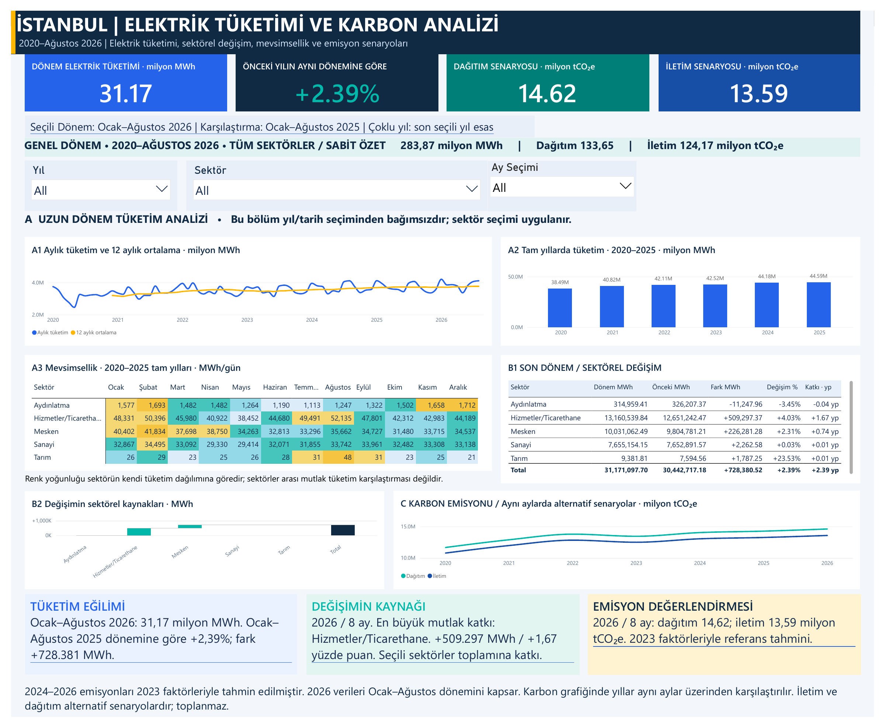

# İstanbul Elektrik Tüketimi ve Karbon Analizi | Power BI

**Rana Beyza Culus · İTO SoftITo Veri Analitiği – 2**  
Ocak 2020–Ağustos 2026 · 400 kayıt · 80 ay · 5 standart tüketici grubu

İstanbul'un aylık, sektörel **faturalanan elektrik tüketimini** ve bu tüketimle ilişkili tahmini dolaylı sera gazı emisyonlarını inceleyen etkileşimli Power BI raporu. Önceki [Python/Pandas analizindeki](../01-istanbul-elektrik-karbon-analizi/) tüketim verileri, Power Query dönüşümleri, ilişkisel model ve DAX ölçüleriyle raporlanmıştır. İki çalışma aynı veri temelini kullanır; bu proje bağımsız yeni bir veri toplama çalışması değildir.

**[Power BI dosyasını indir](Istanbul_Elektrik_Karbon_Analizi.pbix)** · [DAX ölçüleri](model/measures.dax) · [Yöntem ve inceleme notları](METHODOLOGY.md) · [Veri kaynakları](SOURCES.md)

## Dashboard önizlemesi



Güncel Power BI raporunun PDF dışa aktarımından alınmıştır. Dilimleyiciler tüm değerleri kapsar; dönem KPI'ları son verili yıl olan **2026 Ocak–Ağustos** dönemini gösterir. Görsel statiktir; etkileşimli inceleme için PBIX dosyasını açın.

## Raporun yanıtladığı sorular

- Aylık tüketim ve 12 aylık hareketli ortalama nasıl değişiyor?
- Tam yılların tüketimi ve sektörlerin mevsimsel profilleri nasıl farklılaşıyor?
- Seçilen dönemdeki değişime hangi tüketici grupları katkı sağlıyor?
- Aynı aylar karşılaştırıldığında iletim ve dağıtım faktörleriyle hesaplanan emisyonlar nasıl değişiyor?

## Rapor yapısı ve kullanım

Tek rapor sayfası, **İstanbul | Portföy Analizi**, 1920 × 1570 boyutundadır. Yıl, sektör ve ay dilimleyicileri bulunur.

| Bölüm | İçerik | Filtre davranışı |
| --- | --- | --- |
| Dönem KPI'ları | Tüketim, önceki yılın aynı dönemine göre değişim, iki emisyon senaryosu | Seçili son yılın ayları ve sektörleri |
| Genel dönem özeti | Tüm veri için sabit tüketim ve emisyon toplamları | Filtrelerden bağımsız metin |
| A1 | Aylık tüketim ve 12 aylık hareketli ortalama | Yıl ve ay dilimleyicilerinden bağımsız; sektör seçimi geçerli |
| A2 | 2020–2025 tam yıl tüketimleri | Yıl ve ay dilimleyicilerinden bağımsız; sektör seçimi geçerli |
| A3 | 2020–2025 sektör/ay mevsimsellik matrisi, MWh/gün | Yıl ve ay dilimleyicilerinden bağımsız; sektör seçimi geçerli |
| B1–B2 | Sektörel değişim tablosu ve şelale grafiği | Son seçili yıl, seçili aylar ve sektörler |
| C | Aynı aylarda alternatif emisyon senaryoları | Yıl, ay ve sektör seçimi geçerli |
| Bulgular | Tüketim, sektörel katkı ve emisyon açıklamaları | Dönem/sektör seçimine göre dinamik |

Birden fazla yıl seçildiğinde üst KPI'lar ve sektörel katkı bölümü **en son seçili yılı** esas alır. Önceki yılın aynı aylarıyla karşılaştırma yapılır; 2026 için yalnızca Ocak–Ağustos verisi vardır. İlk yıl olan 2020'nin önceki dönem karşılığı veri setinde bulunmadığından değişim boş döner.

Isı haritasındaki değerler günlük ortalama tüketimdir. Renkler sektörün kendi referansına göre hesaplanan mevsimsellik endeksini temsil eder; farklı sektörlerin renklerini mutlak tüketim büyüklüğü olarak karşılaştırmayın.

## Veriden yeniden hesaplanan bulgular

| Gösterge | Sonuç |
| --- | ---: |
| 2020–Ağustos 2026 toplam faturalanan tüketim | 283,87 milyon MWh |
| Aynı genel dönem: dağıtım senaryosu | 133,65 milyon tCO₂e |
| Aynı genel dönem: iletim senaryosu | 124,17 milyon tCO₂e |
| 2026 Ocak–Ağustos tüketimi | 31,17 milyon MWh |
| 2026 Ocak–Ağustos / 2025 aynı aylar değişimi | +%2,39 |
| Bu değişime Hizmetler/Ticarethane katkısı, tüm sektörler seçiliyken | +1,67 yüzde puan |

Genel dönem toplamları yaklaşık 6 yıl 8 aylık birikimli değerlerdir; tek bir yılın sonucu değildir. Yukarıdaki değerler CSV ve PBIX'e gömülü veriler üzerinden kontrol edilmiştir. Kaynak raporların bu incelemede yeniden satır satır doğrulandığı veya Power BI filtrelerinin uygulamada çalıştırılarak test edildiği iddia edilmez.

## Model ve hesaplama

- `Elektrik_Tuketimi`: ay/tüketici grubu düzeyindeki 400 kayıt.
- `Dim_Takvim`: veride bulunan 80 ayın ay başlangıçları; günlük takvim değildir.
- `Dim_Sektor`: standartlaştırılmış 5 grup.
- `Emisyon_Faktorleri`: 2020–2026 için 7 yıllık faktör kaydı.

Tüketim tablosu; sektör, tarih ve yıl alanlarıyla diğer üç tabloya aktif, çoktan-bire ve tek yönlü ilişkilerle bağlanır. Modelde 29 DAX ölçüsü bulunur. Özgün ölçüler ve dört Power Query sorgusu [model/](model/) altında incelenebilir. PBIX'in yerel tarih tabloları da vardır; ana rapor alanları `Dim_Takvim` üzerinden tanımlanmıştır.

Emisyon hesabı satır bazında **MWh × tCO₂e/MWh** şeklindedir. 2020–2023 için veri setindeki yıllık faktörler, 2024–2026 için sabit 2023 referans faktörleri kullanılır. Bağlantı türü tüketim verisinde bulunmadığından iletim ve dağıtım alternatif senaryolardır; **toplanmazlar**. Sonuçlar İstanbul'un tüm enerji kaynaklarını kapsayan toplam karbon ayak izi değildir.

## Power BI Desktop ile açma ve yenileme

1. Depoyu indirin veya klonlayın; bu proje klasörünü dosya yapısıyla birlikte saklayın.
2. Windows üzerinde Power BI Desktop ile `Istanbul_Elektrik_Karbon_Analizi.pbix` dosyasını açın. GitHub PBIX'i etkileşimli olarak çalıştırmaz; bir Power BI Service yayın bağlantısı sunulmamaktadır.
3. Yenilemeden önce **Transform data → Data source settings → Change Source** üzerinden iki CSV kaynağını `data/` içindeki dosyalara yönlendirin. Özgün sorgularda uzak masaüstüne ait `\\tsclient\pbi\...` yolları kayıtlıdır.
4. Kaynak listesi görünmüyorsa Power Query'de `Elektrik_Tuketimi` ve `Emisyon_Faktorleri` sorgularının **Source/Kaynak** adımlarını düzenleyin. Diğer iki sorgu bunlara referans verir.
5. Tüketim dosyasının virgül ayırıcı/UTF-8 ve `en-US` sayı dönüşümü; faktör dosyasının noktalı virgül ayırıcı ve Türkçe ondalık virgül ayarı korunmalıdır. **Close & Apply** ile yükleyin.
6. Dilimleyicileri temizleyin. Genel toplamı ve 2026/2025 Ocak–Ağustos karşılaştırmasını yukarıdaki kontrol değerleriyle karşılaştırın.

### Ham veri ve dönüşümler

`data/` içindeki tüketim CSV'si, son gönderilen **10 sütunlu ham dosyanın değiştirilmemiş kopyasıdır**. Veri temizliği ve sektör adı standardizasyonu PBIX içindeki Power Query adımlarında yapılır. `kaynak_tablo` ve `kaynak_dosya`, ham dosyadaki ek izlenebilirlik alanlarıdır. Mevcut sorgu `Columns=8` ile ilk sekiz alanı modellemektedir; ek iki alan yüklü modelde bulunmaz.

PBIX ve emisyon faktörleri dosyası da gönderilen dosyalarla aynı içerikte korunmuştur. Tüketim değerleri değiştirilmemiştir. Kaynak yolunu güncelledikten sonra Power Query önizlemesinde ilk satırın başlık, tüketim alanının sayısal ve sektör sayısının dönüşüm sonrası beş olduğunu kontrol edin.

## İnceleme ve yeniden üretim

İsteğe bağlı sayısal kontrol, ek paket kurmadan Python 3 ile çalışır:

```bash
python validation/check_data.py
```

Bu kontrol CSV tutarlılığını ve temel hesapları sınar; DAX motorunu çalıştırmaz. Ayrıntılar [METHODOLOGY.md](METHODOLOGY.md) dosyasındadır.
