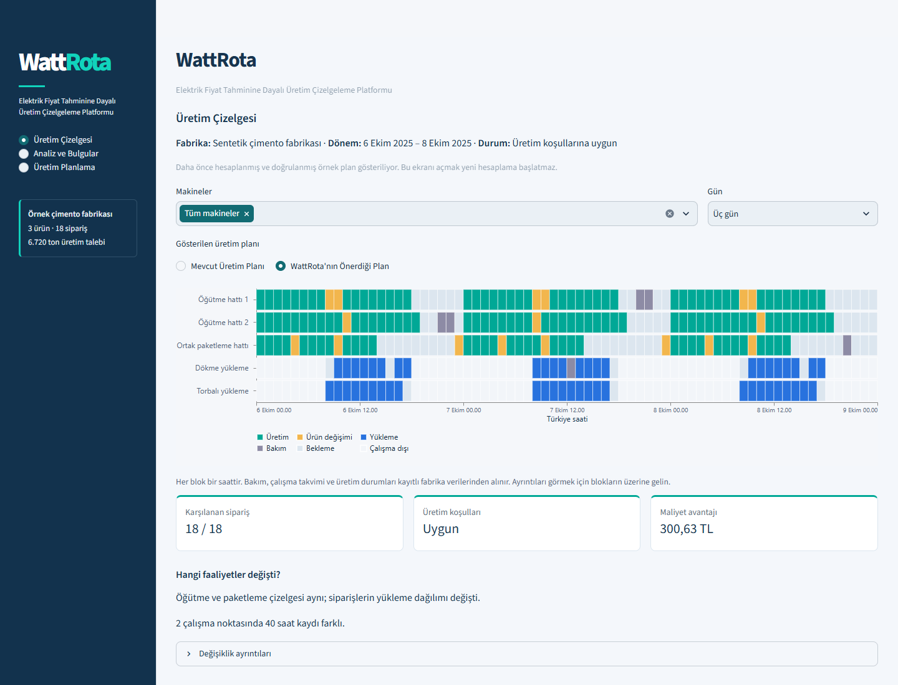

# WattRota

Elektrik Fiyat Tahminine Dayalı Üretim Çizelgeleme Platformu

WattRota, açıklanmış saatlik elektrik fiyatlarını ve henüz açıklanmamış saatlerin tahminlerini kullanarak sentetik bir çimento firmasının 72 saatlik üretim çizelgesini oluşturur. Uygunluk bağımsız denetlenir; aynı çizelgenin beklenen ve gerçekleşen fiyatlarla maliyetleri ayrı hesaplanır. Süre sınırlı MILP çözümleri kesin optimum olarak sunulmaz.

## Proje raporu

- [Nihai proje raporu — PDF](belgeler/Proje_Raporu.pdf)
- [Nihai proje raporu — düzenlenebilir DOCX](belgeler/Proje_Raporu.docx)
- [Veri sözlüğü](belgeler/Veri_Sozlugu.csv)
- [Dosya açıklamaları](belgeler/Dosya_Aciklamalari.csv)

Nihai veri sözlüğü `belgeler/Veri_Sozlugu.csv` dosyasıdır; alan açıklamaları, birimler, anahtarlar ve ilişkileri içerir.

Akademik makale: (https://medium.com/@beyzarana2403/daha-i%CC%87yi-fiyat-tahmini-daha-ucuz-%C3%BCretim-plan%C4%B1-demek-mi-wattrota-3f359f682b5b?sharedUserId=beyzarana2403)

## Teknolojiler ve uygulama

Python, pandas, NumPy ve Jupyter ile veri analizi; scikit-learn ile fiyat tahmini; HiGHS ile karma tamsayılı doğrusal programlama (MILP); SQLAlchemy ve PostgreSQL ile veri erişimi; Streamlit ve Altair ile kullanıcı arayüzü kullanılır.

Uygulama üç sayfadan oluşur: **Üretim Çizelgesi**, **Analiz ve Bulgular**, **Üretim Planlama**.



## Kurulum ve açılış

Windows, Python 3.14 ve paket kurulumu için internet gerekir. Doğrulama Python 3.14.6 ortamında yapılmıştır. Proje klasöründe `KURULUM.bat`, ardından `BASLAT.bat` dosyasını çalıştırın. Başlatıcı yalnız proje içindeki `.venv` ortamını kullanır; başka bilgisayardaki sanal ortamı aramaz. 8508 portu doluysa diğer Streamlit örneğini kapatın.

Elle kurulum:

```powershell
py -3.14 -m venv .venv
.venv\Scripts\python -m pip install -r requirements.txt
cd uygulama
..\.venv\Scripts\python -m streamlit run app.py --server.port 8508
```

### Veritabanı gerektirmeyen kayıtlı demo

Uygulama, `uygulama/runs/20261111_232421_67cf3c75` içindeki doğrulanmış tarihsel planı açar. Bu kayıt **yeni hesaplama değildir**. Üretim Çizelgesi, Analiz ve Bulgular, Üretim Planlama sayfaları incelenebilir. PostgreSQL veya `.env` olmadan kayıtlı plan görüntülenebilir.

### Yeni hazır fabrika planı: PostgreSQL gerekir

1. PostgreSQL sunucusunu kurun. `sql/00_veritabani_olustur.sql` ile `wattrota` veritabanını oluşturun.
2. Proje kökünde `python scripts/veritabani_sql_hazirla.py` çalıştırın. Oluşan `data/database_import/firma_01_yukle.sql` dosyasını wattrota veritabanında çalıştırın; ardından `sql/01_veritabani_kontrol.sql` ile kontrol edin. Mevcut şemanın üzerine yazılmaz. Ayrıntılar: `docs/postgresql-kurulum.md`.
3. `.env.example` dosyasını yerelde `.env` olarak kopyalayın; kendi bağlantı bilgilerinizi girin. Bu dosyayı paylaşmayın. DB_HOST, DB_PORT, DB_NAME, DB_USER, DB_PASSWORD ortam değişkenleri de desteklenir.
4. Üretim Planlama sayfasındaki **Üretim Planını Oluştur** butonu mevcut ön iyileştirme ve MILP motoruyla yeni çözüm hesaplar. Sayfa geçişi yeni optimizasyon başlatmaz.

İlk günün bilinen fiyatları ile sonraki 48 saatin mevcut tahmin kodu kullanılır. Tarihsel yayın zamanı önceki gün saat 14.00 varsayımıdır; gerçek yayın gecikmelerinin arşivi yoktur. Gelecek gerçekleşmiş fiyatlar karar girdisi değildir. Gerçek fiyatlarla değerlendirme, plan saklandıktan sonra aynı plan üzerinde yapılır. Yeni sonuçlar uygulama/runs altında ayrı kimlikle tutulur.

## İçerik

- `notebooks/`: Sekiz orijinal Notebook; Markdown, grafik ve kayıtlı çıktılar korunmuştur.
- `src/`, `kod/db/`, `scripts/`, `sql/`: Tahmin, MILP, bağımsız doğrulama ve veritabanı kaynakları.
- `uygulama/`: Son üç sayfalı uygulama; `legacy/` uygulamanın kullandığı korunmuş kaynak kopyalarını içerir. Import yapısı nedeniyle gereklidir.
- `data/raw/epias/`: Üç EPİAŞ PTF CSV'si, 24.984 saat.
- `data/synthetic/firma_01/`: Sentetik fabrika, varsayımlar ve alan sözlüğü.
- `belgeler/Veri_Sozlugu.csv`: Nihai veri sözlüğü. `veri/veri_sozlugu_taslak.md`, PostgreSQL kataloglarından çıkarılmış teknik şema taslağıdır.
- `data/results/delivery_evaluation/`: Doğrulanmış 10 ayrı 72 saatlik planlama penceresinin toplu değerlendirmesi.
- `data/results/direct_milp_04_development_60s/`: Ayrı koşum kayıtları ve denetimleri.
- `experiments/`: Raporlanmış akademik sonuçların kaynakları ve ayarları. Çalıştırmak uygulama açılışı için gerekli değildir.
- `tests/`, `uygulama/tests/`: Model, veri, analitik ve ekran kontrolleri.
- `uygulama/ekran_goruntuleri/`: Yalnız inceleme_01–inceleme_08 son sürüm görüntüleri.
- `belgeler/`: Onaylı nihai proje raporu (DOCX/PDF), veri sözlüğü, dosya açıklamaları, logo.
- `teslim_kontrol/`: Kopyalama, bütünlük, güvenlik ve test kayıtları.

## Notebook ve test kullanımı

Notebook'ları VS Code Jupyter desteğiyle, proje ortamını kernel seçerek açın. Notebook çalışma dizini `notebooks/` olmalıdır. Kayıtlı çıktılar yeniden hesaplama gerektirmeden incelenebilir. Bazı hücreler uzun deneyleri yeniden çalıştırabilir; tamamını otomatik çalıştırmak teslim kontrolünün parçası değildir.

```powershell
cd uygulama
..\.venv\Scripts\python -B tests/run_final_checks.py
..\.venv\Scripts\python -B -m unittest discover -s tests -p test_ui_refinement.py
```

PostgreSQL yapılandırması yoksa bağlantı testi açıkça atlanır. Eski V2 klasörünün değişmezlik testi, eski sürümler pakete alınmadığından arşiv kontrolü olarak atlanır. Diğer eski araştırma testleri optimizasyon başlatabilir; yalnız ilgili yönergeyle çalıştırılmalıdır.

## Bulguların kapsamı

Ana geliştirme değerlendirmesi, başlangıç tarihleri 5 Ocak–9 Mart 2026 arasında haftalık aralıklarla seçilmiş 10 ayrı 72 saatlik planlama penceresini kapsar. Buradaki “10 hafta”, kesintisiz 10 haftalık üretim simülasyonu anlamına gelmez. Teslim süresi nedeniyle kronolojik akış güvenli kayıt noktasında durduruldu; haftalar sonuçlara göre seçilmedi. Toplam avantajlar HGB günlük yeniden planlama için 40.079,47 TL, ensemble için 21.064,23 TL, basit yöntem için 19.483,39 TL'dir. Bunlar uygulamadaki tek Ekim 2025 demo sonucundan ve eski pilot/havuz çalışmalarından ayrıdır. Kalan 24 geliştirme haftası ve kilitli 10 hafta değerlendirilmedi.

## Sınırlılıklar ve gelecek geliştirmeler

Veriler gerçek bir tesis ölçümü değil, fiziksel kurallarla tanımlanmış sentetik fabrika senaryosudur. PTF tüm bedeller dahil elektrik faturası değildir. Daha doğru tahmin her zaman daha düşük maliyet demek değildir. Canlı fiyat erişimi yoktur. Kullanıcı Excel yüklemesi yalnız yapısal doğrulamadır; kullanıcı verileriyle optimizasyon yapılmaz.

Gelecek çalışmalar: üretim kısıtlarının uygulama üzerinden değiştirilmesi, farklı fabrikalar için otomatik çizelgeleme, canlı EPİAŞ bağlantısı, isteğe bağlı yeniden planlamanın uygulamaya entegrasyonu; ayrıca yapılmayan stok/güç duyarlılık analizi ve kalan haftalar.

## Veri kaynakları ve paylaşım

PTF: [EPİAŞ Şeffaflık Platformu](https://seffaflik.epias.com.tr/). Veri dosyaları kaynak tarih aralıklarıyla korunmuştur. Kuramsal kaynaklar ve bağlantılar `docs/` ve nihai proje raporundadır. Ekran görüntüleri bu projeye aittir. Üçüncü taraf veri/yazılımların kendi kullanım koşulları geçerlidir. EPİAŞ platformunun kaynak göstererek kullanım koşulu esas alınmıştır; veri için ayrı bir açık lisans iddia edilmez. Kod için yazar adına rastgele lisans seçilmemiştir.

## Bu teslim kontrolünün sınırı

Kontroller bu bilgisayarda mevcut Python ortamıyla, yeni klasörün içinden yapıldı; temiz bir bilgisayara internetten bağımlılık kurulumunun tamamı denenmedi. BASLAT.bat için sanal ortam bulunmama davranışı kontrol edildi.

Eski menülere yönelik testler tarihsel kaynak olarak korunmuştur. Güncel desteklenen test girişleri yukarıdaki iki komut ve `python teslim_kontrol/test_package.py` komutudur. Browser kontrolü isteğe bağlı Node.js, Playwright ve Chrome gerektirir; `WATTROTA_TEST_URL` ile adres ayarlanabilir.
